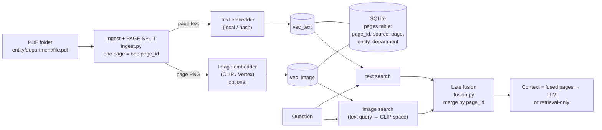

# multimodal-page-rag

**Theme: choosing the "cut unit" before you embed, and merging text + image evidence with late fusion.**

A small local RAG demo on SQLite + [sqlite-vec](https://github.com/asg017/sqlite-vec). Documents are PDFs with text *and* figures. The retrieval unit is a **page**; the text and the picture of a page share one `page_id`, so hits from different modalities can be merged.

> The sample corpus is a **fictional** Hong Kong group, *Harbour Lane Group Limited*, with a Hong Kong head office and a Shenzhen subsidiary, each split into departments. Policies are invented for teaching; nothing here is legal or HR advice.

## What you will learn

1. The cut unit (page / section / image+caption) is chosen at **ingest**, upstream of embedding. Embedding APIs never chunk for you.
2. Why text vectors and image vectors live in **separate indexes** (different models, different dimensions).
3. **Late fusion**: retrieve per modality, then merge by `page_id`, and why raw scores can't simply be added.
4. How a company's folder structure (`entity/department/`) becomes retrieval **metadata**, and the pitfall of filtering *after* top-k.

## The part you can lift out

[`src/mmrag/fusion.py`](src/mmrag/fusion.py) is a single zero-dependency file (RRF and min-max fusion over ranked lists). Copy it into any project that merges results from several retrievers; it has its own tests in `tests/test_fusion.py`.



## Quickstart

```bash
uv sync
uv run mmrag ingest examples/harbour-lane          # text-only index, works offline
uv run mmrag query "how many days of annual leave do staff get?"
uv run mmrag query "who approves taxi fares over HKD 300?" --dept finance
uv run mmrag stats
```

Out of the box this uses the dependency-free `hash` text embedder (keyword-like, with a printed warning) and **skips image embedding with a clear message**. For real semantics and the image path:

```bash
uv sync --extra images                 # pypdfium2 + pillow + sentence-transformers (CLIP)
INDEX_MODE=multimodal uv run mmrag reset --rebuild examples/harbour-lane
uv run mmrag query "bar chart of quarterly expense claims" --mode image
uv run mmrag query "quarterly expense claims by department" --mode fusion
```

## Two indexing modes (`index_mode` in `mmrag.toml`)

| | A) `text` | B) `multimodal` |
|---|---|---|
| Unit | page | page (same `page_id`) |
| Vectors | page text → text model | page text → text model **and** page PNG → image model |
| Figure-only / scanned pages | dropped (no text layer, no OCR) | kept via the image vector |
| Needs | nothing extra | `.[images]` or Vertex credentials |

## Retrieval modes (`mmrag query --mode …`)

| Mode | How |
|---|---|
| `text` | embed question with the text model, search `vec_text` |
| `image` | embed the question **text** with the multimodal model (CLIP puts text and images in one space), search `vec_image` |
| `fusion` | run both, then merge by `page_id` with RRF (default) or min-max. Output shows each page's rank and raw cosine per modality |

If no image index exists, `fusion` falls back to text and says so.

### Classic text RAG vs this demo

| | Classic text RAG | This demo |
|---|---|---|
| Unit | text chunks (by size/overlap) | whole pages |
| Modalities | text | text + page image |
| Figures / charts | lost unless described in text | searchable through the image vector |
| Merge | single ranking | late fusion across rankings |
| Scanned PDF | fails (no text) | still indexed in mode B |
| Cost | cheap | page rendering + image model |

## Failure modes (read these)

- **No OCR.** A scanned page has no text layer: mode A drops it; mode B keeps it, but only the image vector can find it, and CLIP is weak at reading small print.
- **Score scales differ.** CLIP text→image cosine is typically ~0.2–0.35 for good matches; text→text is often 0.5+. Don't add raw scores. That's why fusion uses ranks (RRF) or normalisation.
- **Page = too coarse?** A long page is one vector and may exceed the text model's token limit (truncated silently). Pick a smaller unit (section) if your pages are dense.
- **Filter after top-k.** The org filter (`--dept`) is applied after the vector search, so the candidate pool is widened ×5 when filtering; a very selective filter can still return fewer than k.
- **Embedders must match.** The index records its models; querying with a different one is refused.

## Configuration

See `mmrag.toml`. Env vars: `MMRAG_DB`, `INDEX_MODE`, `TEXT_PROVIDER`, `TEXT_MODEL`, `IMAGE_PROVIDER` (`clip` | `vertex` | `none`), `IMAGE_MODEL`, `LLM_PROVIDER`, `LLM_MODEL`; LLM keys `OPENAI_API_KEY`, `GEMINI_API_KEY`, `OLLAMA_MODEL`.

**Optional Vertex AI** (`IMAGE_PROVIDER=vertex`): `multimodalembedding@001`; set `GOOGLE_CLOUD_PROJECT` (and optionally `GOOGLE_CLOUD_LOCATION`), plus `VERTEX_ACCESS_TOKEN` or a logged-in `gcloud`. This path is not covered by tests.

## Layout

```
src/mmrag/   ingest.py (page split) embed.py store.py retrieve.py fusion.py (standalone) index.py generate.py cli.py
examples/harbour-lane/{hk-hq/{hr,finance,compliance}, sz-subsidiary/operations}/*.pdf   (regenerate: python tests/make_examples.py)
tests/       fusion, store/pipeline with a stub multimodal embedder (no downloads)
LEARNING.md  繁體中文 (zh-HK) + English
```

## Contributing

Good first issues: section-level units, OCR for scanned pages, a Streamlit viewer that shows the page PNGs next to scores, a Gemini multimodal embedder. Keep `fusion.py` dependency-free. MIT licensed.

## License

MIT
